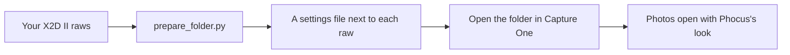
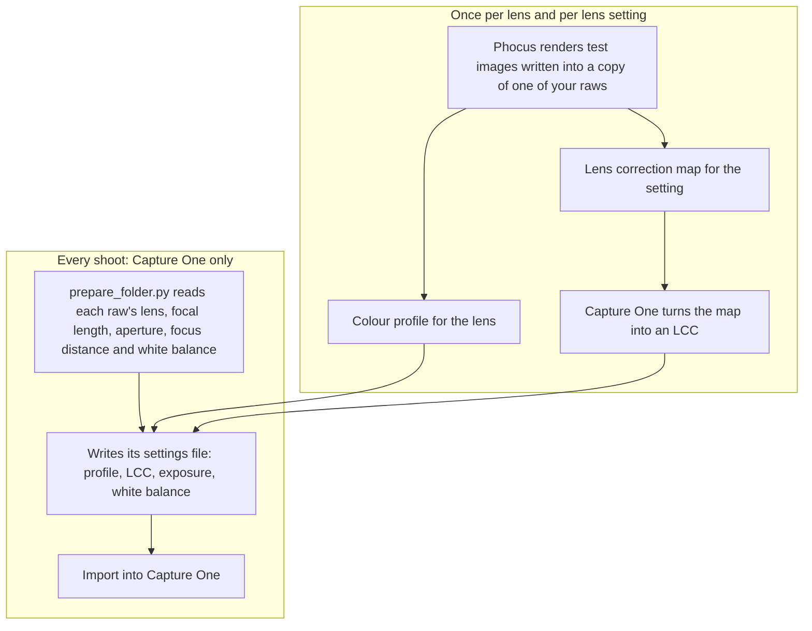

# HNCS for Capture One

Hasselblad's own raw software, Phocus, renders X2D II photos with Hasselblad's colour (HNCS, the
Hasselblad Natural Colour Solution) and its own lens corrections. This project makes Capture One render
the same raw files the same way, closely enough that the two are hard to tell apart side by side. Your raw
files aren't changed and no copies are made.


*Left: Phocus (Standard, lens corrections on). Middle: Capture One with this project's settings. Right:
Capture One's default. The number on each Capture One image is its median colour difference from Phocus
over the whole frame, in ΔE00. Around 1 is about the smallest difference you can see side by side.*

This is a personal project. It isn't affiliated with Hasselblad or Capture One.

## How it works

Phocus does three things to every X2D II raw that Capture One doesn't. This project reproduces each one
with something Capture One already understands:

| Phocus does this | Capture One gets it from |
|---|---|
| **Colour:** HNCS, Hasselblad's colour and tone rendering | a camera profile for each lens |
| **Lens correction:** brightens the corners and evens out a slight blue shift toward the edges, differently for every lens, focal length, aperture and focus distance | an LCC (Capture One's flat-field correction) made for each lens setting |
| **Camera calibration:** reads a factory calibration record from each raw, so every X2D II renders alike | exposure and white balance adjusted for your camera |

All three are written into a Capture One **settings file** next to each raw before you import it. Capture
One reads that file when it first opens the photo, so the photo arrives already looking like Phocus, and you
edit from there as usual.



Phocus is needed only the first time a lens, or a lens setting, turns up. That's when its colour and lens
correction are measured:



## What's included

- **Profiles** for the XCD 28P, 35-100, 38V, 25V, 55V, 90V, 120 Macro and 135, each in four versions for
  tungsten, warm, daylight and shade light, picked automatically from each photo's white balance. Profiles
  for any other XCD lens can be made from one of your raws.
- **Lens correction maps** for the 60 lens settings measured so far. Capture One's LCCs are made from them
  on your own computer, because each LCC records your camera's serial number. Maps for new settings can be
  measured with Phocus.
- **Tools** that do all of this with one command.

## Install

You need macOS, Capture One 16.9, Python 3, and Phocus 4.2 for adding new lenses or lens settings.

1. Set up the tools:
   ```sh
   python3 -m venv .venv && .venv/bin/pip install -r tools/requirements.txt
   ```
2. Install the profiles for your camera, giving it any raw you shot with that camera:
   ```sh
   .venv/bin/python tools/bake_lcc_colour.py --body ~/Pictures/MyShoot/Capture/B0001234.3FR
   ```
   Every X2D II carries a factory calibration that Phocus corrects for. This builds your camera's into the
   profiles it installs in `~/Library/ColorSync/Profiles/`.
3. Restart Capture One, which only finds new profiles when it starts.

The profiles are made to be used with the settings files below. Each one includes a small colour
correction that belongs with its lens's LCC, so choosing one by hand on a photo without the LCC gives a
slight colour cast.

## Use

Before Capture One has seen the photos, run:

```sh
.venv/bin/python tools/prepare_folder.py ~/Pictures/MyShoot/Capture
```

Then open that folder in a Capture One session, or import it into a catalog with **Include existing
adjustments** ticked (it is by default), either leaving the files where they are or copying them in. Each
raw gets a settings file and a copy of its lens correction in `CaptureOne/Settings1690/` inside that
folder, about 28 KB per photo. That's the folder where Capture One keeps its own per-photo settings anyway.
Your raw files aren't touched.

A typical line of output:

```
B0000919.3FR: XCD28P_28mm_f8.0_d0.npz, exposure -0.014 EV, LCC XCD28P_28mm_f8p0_d0, profile HNCS E5 28P
```

### The first time you use a lens or lens setting

A lens setting is the lens, focal length, aperture and focus distance. Each one needs a map and an LCC.
Without an LCC, `prepare_folder.py` says so and uses a simpler, less accurate correction; without a map it
skips the photo. So the first time, and whenever you've shot a new setting, add:

```sh
.venv/bin/python tools/prepare_folder.py ~/Pictures/MyShoot/Capture --make-maps --make-profiles --make-lccs
```

| Option | What it does | Needs | Time |
|---|---|---|---|
| `--make-maps` | measures Phocus's lens correction for each new lens setting | Phocus (don't use it meanwhile) | about 25 s per setting |
| `--make-profiles` | builds a colour profile for each new lens; restart Capture One afterwards | Phocus | about 5 min per lens |
| `--make-lccs` | turns each new lens correction into an LCC | Capture One open on a separate "lab" session | about 1.5 min per setting |

For `--make-lccs`, create an empty Capture One session that you use only for this (call it "HNCS Lab"),
keep it open, and pass its Capture folder with `--lab ~/Pictures/HNCS\ Lab/Capture`. It also needs the test
profile installed once, before Capture One starts:

```sh
.venv/bin/python tools/build_probe.py ~/Library/ColorSync/Profiles
```

Each option only does the work that's missing, so it's safe to leave them on. LCCs are kept in
`data/lcc_c1/`, which isn't committed.

## How close it gets

Median colour difference from Phocus (lens corrections on), in ΔE00, on photos that weren't used to
build anything:

| Photos | Whole frame | Corners |
|---|---|---|
| 28P, 7 photos at f/4 to f/16 | 0.48 | 0.60 |
| 35-100, 16 photos at 35 to 100 mm | 0.46 | 0.48 |
| Another X2D II, one photo each from the 25V, 55V, 90V, 120 Macro and 135 | 0.33 | 0.35 |
| For comparison: Capture One's default, on the seven photos above | 2.9 to 6.3 | |

"Corners" is everything beyond 80% of the way from the centre to a corner.

## Limits

- **Highlights.** Where a sensor channel clips, Phocus keeps some colour and its Highlight Recovery can
  rebuild the clipped channel. Capture One can't, and no profile changes that.
- **White balance.** Each photo gets the profile for its As Shot white balance: tungsten below about
  4000 K, warm up to 4850 K, daylight up to 6200 K, and shade above that. Real photos so far cover the 28P
  and 35-100 in warm light and shade, and the 35-100 under tungsten; the rest is checked on synthetic grids.
  Mixed light hasn't been tested.
- **Brightness.** Some photos come out slightly brighter or darker than Phocus overall, by up to about
  0.5 L\* (0.03 stop).
- **Changing white balance** in Capture One keeps the colour right on the camera you installed the
  profiles for. Photos from a different X2D II carry that camera's correction in their white balance
  instead, so a preset, a Kelvin value or As Shot drops it (about 1.3–2.0 ΔE00); the white-balance picker on
  a grey patch doesn't. Lens settings without an LCC get a simpler correction, and changing their white
  balance shifts colour slightly too.
- **New photos only.** Capture One applies a settings file only to a photo it hasn't seen yet, so run
  `prepare_folder.py` before opening or importing the folder.
- **Phocus's defaults.** The match is to Phocus's Standard response in its default working space.
- **Camera.** Hasselblad X2D II 100C only.

## Repository layout

```
profiles/   Capture One camera profiles ("HNCS E5 <lens>", plus Tungsten, Warm and Shade; E5 is the version)
tools/      prepare_folder.py and the scripts behind it (see tools/README.md)
fit/        fitted colour tables, lens correction maps, and the data needed to rebuild them
docs/       how it was measured and everything found along the way
```

## More detail

- [docs/phocus-hncs.md](docs/phocus-hncs.md): everything learned about how Phocus renders an X2D II raw,
  and a table of the corrections each raw gets, by body, lens, light and lens setting.
- [docs/methodology.md](docs/methodology.md): how Phocus's colour and lens correction were measured,
  and how they're reproduced.
- [tools/README.md](tools/README.md): the scripts.
- [docs/open-questions.md](docs/open-questions.md): what's still open.
- [docs/research-log.md](docs/research-log.md): the project's history. Every experiment in order,
  including approaches that were tried and dropped.

## Credits

[blog.tonalphoto.com](https://blog.tonalphoto.com/) for the Lightroom profile that inspired this, for its
measurements of Phocus, and for sample raws from five more lenses and another camera.

## License

[MIT](LICENSE) for the profiles, tables, data, tools and docs. The example photographs in
`docs/images/` are © Scott Walker, all rights reserved.
