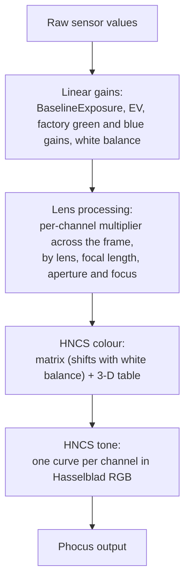

# How Phocus renders an X2D II raw, and what it takes to match it

Everything this project learned about how Phocus applies HNCS to a Hasselblad X2D II 100C raw, in one
place, and every correction each raw needs so that Capture One renders it the same way. The measurements
behind each statement are in [research-log.md](research-log.md); "F12" means its Finding 12. Phocus 4.2.2
and Capture One 16.9 throughout.

## In short

Phocus does more to a raw than "apply HNCS". Taken in the order the evidence supports:

1. **Linear gains on the raw values.** BaselineExposure and the EV slider, a green and a blue gain from a
   factory calibration record that every X2D II writes into its raws, and white balance.
2. **Lens processing**, looked up from a 34-byte lens identity in the raw against data built into Phocus:
   less blue toward the edges, an edge lift (lens corrections off) or a vignetting correction (lens
   corrections on), and a small brightness offset for each lens setting. All of it is a fixed multiplier on
   each channel of the raw, which changes with lens, focal length, aperture and focus distance.
3. **HNCS colour:** a 3×3 matrix that shifts with white balance, then a 3-D colour table that depends on
   hue, saturation and lightness.
4. **HNCS tone:** one tone curve applied to each channel separately, in Hasselblad's own RGB space.

Capture One does steps 3 and 4 with a camera profile, and step 2 with an LCC, but it ignores the factory
record and has no per-lens-setting brightness. So every raw gets a settings file that carries its lens
setting's LCC, an exposure and a white balance, and a profile chosen for its lens and its light.

The linear gains and the lens processing are all per-channel multipliers on linear values, so their order
among themselves makes no difference to the result and wasn't measured.

## How it was measured

X2D II raws store the sensor readout uncompressed (RGGB, 16-bit, black level 4096, white about 64763), so a
copy of a real raw can have its pixels replaced by designed values, such as grids of flat colour patches or a
flat grey, while keeping every piece of metadata. Both apps render such a copy as if it were the original
photo. Each patch then gives an exact pair: the camera RGB Capture One hands to a profile, and the Lab Phocus
produces.

- **Phocus** has no scripting, but its hot folder exports any raw dropped into a watched folder.
  `phocus_hotfolder.py` turns it on through Phocus's preferences, drops a `.phos` sidecar with the wanted
  settings and then the raw, and waits for the export. About 10 s per render.
- **Capture One** renders through a "probe" profile that reads camera RGB as ROMM RGB, so the exported TIFF
  holds exactly what a camera profile would receive.
- **Metadata** questions were settled by swapping maker-note entries, or single bytes, between otherwise
  identical synthetic files, and by reading Phocus's binaries for the sidecar keys.

Scoring on real photos: Phocus (Standard, lens corrections on, As Shot) against Capture One, aligned, cut
into blocks, clipped and near-black blocks and the busiest 30% left out, median ΔE00 over the frame
(`score_render.py`).

## What Phocus reads from a raw

| Input | Where it is | What Phocus does with it | Findings |
|---|---|---|---|
| Sensor data | One SubIFD: 11904 × 8842, uncompressed; active area 11656 × 8742 from (128, 96) | | raw format |
| White balance | `AsShotNeutral` in IFD0 and its maker-note copy | Changes both the channel balance and the HNCS colour matrix | 8, 14 |
| BaselineExposure | IFD0 tag 50730 | Applied as an exposure gain, as Capture One does | background, 12, 25 |
| Body calibration | Maker note 0x0019, a 512-byte record starting `GAIN`; only bytes 84–87 matter, two half-floats | A green and a blue gain on the camera RGB | 1, 2, 13, 16, 35 |
| Lens identity | Maker notes 0x0017 (the shot) and 0x0018 (the lens), 17 bytes each | Looked up in data inside Phocus's HBUtil framework | 29, 30 |
| Aperture | 0x0017 byte 8, 12 × APEX (0x30 f/4, 0x48 f/8) | Vignetting correction | 30 |
| Focal length | 0x0017 byte 14, about 24 × log2(mm) − 76 | Vignetting correction; out of the lens's range, no vignetting correction | 30 |
| Focus distance | 0x0018 byte 6: 0 at infinity, rising as focus gets closer | Vignetting correction and centre brightness; past the lens's table, no vignetting correction | 31, 36 |

Phocus **ignores**: the EXIF lens name, EXIF SubjectDistance (which on these files doesn't say where the
lens was focused: a clover close-up reads infinity), maker-note 0x0081–0x0083 (they look like
temperatures), the firmware string, the serial number, the GAIN record's date, ID and checksum, and the
sidecar's `VLensDistance` and `VLensType` (F2, F12, F29, F30, F31). The sidecar's scene-adaptive options
(`ApplySceneCastCorrection`, `ApplySceneEqualization`, `ApplySceneCalibration`) are off, and Phocus renders
synthetic patches perfectly flat, so there's no local processing at default settings (F5).

## Body calibration

Each X2D II carries a factory record whose two half-floats, g1 and g2, Phocus uses to make every body render
alike. Sweeping them in synthetic files gives (F13, F16):

- green gain kG = (g1 / 2.600)^0.077
- blue gain kB = (g2 / 2.260)^0.078
- red unchanged

relative to the owner's body (2.600, 2.260). The effect is weak: a 15% change in a stored value moves a
channel about 1%. It's the same on every lens and nearly the same at tungsten (the green effect is about a
quarter weaker there). A record of zeros renders as if both values were about 2.1. Because the green gain
moves lightness too, an uncorrected body is off in brightness as well as colour.

The formula was fitted on the owner's and DPReview's bodies, then tested on a third whose record (2.049,
2.250) lies well outside both: swapping that record into a synthetic file moved Phocus's greys by a\* +1.37,
b\* −0.92 against a predicted +1.41, −0.95, and the whole render matched the prediction to 0.07 ΔE00 (F35).
Capture One ignores the record, so a profile made on one body carries that body's calibration.

## Exposure

- **BaselineExposure** is applied by both apps the same way (DPReview frames tagged +1 and +2 EV fit as well
  as untagged ones). Synthetic copies need it set to 0, because their reference measurements were made at 0.
  A profile built from a host carrying +0.067 came out 1.2 L\* brighter in the midtones (F26).
- **The sidecar's `EV`** is a linear gain before the tone curve: 2.0 renders a grey exactly as twice the raw
  level does. A push in Phocus, or in Capture One, renders the same as more light (within 0.10 and 0.02 ΔE00),
  so pushing adds no difference of its own (F33).

## Lens processing

Phocus doesn't read lens corrections from the raw; the whole maker note is 22.5 KB. It reads the lens
identity from 0x0017 and 0x0018 and looks the lens up in its 119 MB HBUtil framework, which names every XCD
lens. Copying those two entries from a 28P raw into a 35-100 file makes Phocus treat it as a 28P in every
respect. Copying 0x0018 alone, mismatched with the rest, switches lens processing off entirely, which shows
Phocus's "no lens" baseline (F29). Identities from original-X2D raws work on X2D II files (F30).

### Four effects

Measured with synthetic flat fields, each read back through the lens's own table into a per-channel gain map:

| Effect | Lens corrections | What it does | Depends on | Findings |
|---|---|---|---|---|
| **Colour shading** | on and off | Less blue, and slightly more red, toward the edges | Lens; eases with focal length on the 35-100; hardly at all on aperture or focus | 5, 6, 31 |
| **Edge lift** | off | A mild brightening toward the edges | Lens; on the 55V a little on focus | 6, 31, 36 |
| **Vignetting correction** | on | Brightens toward the edges far more than the lift: about 2 stops at r 0.9 on the 28P | Lens, focal length, aperture and focus | 6, 22, 31, 36 |
| **Lens-setting brightness** | on and off | Shifts the whole frame's brightness slightly | Lens, focal length, aperture and focus | 3, 27 |

**All of it is a fixed multiplier on each raw channel.** The vignetting correction first seemed to shrink
on brighter images, but that was Capture One's raw response, through which the maps were measured.
Converted to raw gains, the correction is the same at any exposure (F12, F22).

**It isn't radially symmetric.** At the same distance from the centre the correction is stronger along the
long side of the frame and a little stronger on the left: on the 28P, 0.06 stop rms away from radial and up to
0.19 stop, against 0.02 stop rms on the 35-100 at 100 mm (F39). A radial falloff curve can only follow the
average around each ring.

**Focus matters on some lenses.** At the closest focus codes, the 28P's corner correction drops by up to 0.07
stop and the 55V's centre darkens by a third of an L\*. The 35-100 barely moves. The 90V moves most: at 90% of
the half-diagonal, its correction rises from +0.24 stop at infinity to +0.65 at code 14 (F31, F36). Colour
shading doesn't change with focus on any lens.

**Past the end of a lens's table, the vignetting correction stops**: from focus code 15 on the 28P and 16 on
the 90V, and with a focal length outside the lens's range. On the 90V "corrections on" then renders exactly
like "corrections off". The colour shading stays (F30, F31, F36).

### With lens corrections off

Corrections off still brightens and shades the frame. On one 35-100 flat (35 mm f/11) carrying each lens's
identity, in Capture One's camera-RGB scale (F29, F30):

| Identity | Edge lift, r 0.6 / 0.9 (stops) | Blue vs green, r 0.6 / 0.9 (stops) | Centre L\* |
|---|---|---|---|
| none (0x0018 mismatched) | 0 / 0 | 0 / 0 | 29.97 |
| 28P | +0.29 / +0.89 | −0.13 / −0.21 | 30.42 |
| 38V, f/11 | +0.15 / +0.50 | −0.08 / −0.16 | 30.43 |
| 55V, f/4 | +0.21 / +0.56 | −0.12 / −0.17 | 30.16 |
| 35-100, 35 mm f/11 | +0.07 / +0.24 | −0.04 / −0.07 | 31.43 |

So the same raw values render up to about 1.5 L\* apart in the centre depending only on which lens the file
says took them. That difference lives in each lens's profile; only the difference between settings of one lens
has to be added per photo. The 90V's lift with corrections off is +0.15 stop at r 0.9, and doesn't change with
focus (F36).

## HNCS colour

### The colour stage

For moderate colours, HNCS behaves like a classic camera profile: a 3×3 matrix, then a tone curve per
channel. What's left is a genuinely three-dimensional table. Models fitted only on moderate colours
(camera-RGB saturation below 0.6), scored on held-out synthetic patches, median ΔE00 (35-100 | 28P, F14):

| Model | Saturation 0–0.3 | 0.3–0.6 | 0.6–0.85 | 0.85–1 |
|---|---|---|---|---|
| Matrix, then a per-channel curve in ProPhoto | 1.02 \| 1.25 | 1.05 \| 1.03 | 2.87 \| 2.69 | 6.94 \| 6.78 |
| Matrix, then an Adobe-style curve in ProPhoto (hue held on max/min channel) | 1.05 \| 1.06 | 1.83 \| 1.82 | 4.54 \| 4.29 | 7.07 \| 6.94 |
| **Matrix, then a per-channel curve in Hasselblad RGB** | 0.86 \| 1.02 | 1.01 \| 0.96 | 1.74 \| 1.71 | 2.22 \| 2.52 |
| … plus a 2-D hue × saturation table | 0.73 \| 0.66 | 0.68 \| 0.62 | 1.67 \| 1.64 | 2.18 \| 2.48 |
| … plus a 3-D hue × chroma × lightness table (36 × 9 × 8), fitted on all | 0.63 \| 0.59 | 0.37 \| 0.37 | 0.74 \| 0.73 | 0.87 \| 0.82 |
| Full 33³ table (what the profiles are) | 0.43 \| 0.49 | 0.27 \| 0.25 | 0.52 \| 0.48 | 1.34 \| 1.31 |

- Most of what looks like HNCS reshaping saturated colours is the tone curve working in a smaller space: in
  Hasselblad RGB a matrix and curve fitted on moderate colours predict the most saturated ones at 2.2–2.5
  instead of 6.8–6.9.
- Moderate colours still need corrections that depend on lightness: a hue-and-saturation table leaves
  0.6–0.7; adding eight lightness levels brings it to 0.37.
- That's the structure of a DNG profile (matrix, 3-D LookTable, tone curve), except a DNG's tone curve runs
  in ProPhoto with Adobe's hue-holding method, the model that fits worst here. Its LookTable has to absorb the
  difference.
- HNCS renders neutral greys slightly green: a\* about −0.6 to −1.8 (F8, F11).
- Brightened by one and two stops at the same camera RGB ratios, red, yellow, cyan, blue and magenta hold
  their hue within ±1.5°; green turns −3.5°, and orange and skin tones +6–7° as they approach the highlights
  (F11).

### White balance changes the colour, not just the balance

HNCS is tied to white balance even within daylight (F8, F14, F33):

- Against the table fitted at one white balance, the warmest grid is off by 1.06 ΔE00 on moderate colours
  (35-100) and 1.32 (28P). Plain white-balance gains don't help; a 3×3 matrix in front of the table brings
  them to 0.37 and 0.43. The matrix's off-diagonal terms grow steadily with white balance (±0.02 to 0.05 between
  R/B 0.54 and 0.76), with opposite signs either side of the reference: like a dual-illuminant DNG profile.
- Saturated colours change by more than a matrix explains.
- A single table therefore fits a band of white balance. The daylight profile matches best near 5500 K; on
  locus grids its error on colourful patches (C\* 20–40) rises to 1.28 at 4500 K and 1.26 at 6500 K, while
  greys stay within 0.5 ΔE00 from 4200 to 8000 K (F33).

So the project uses four profiles per lens, each fitted on grids in its own band (F21, F44, F46, F51). Real X2D
II As Shot neutrals sit slightly off the ColorMatrix1 daylight locus (about 2–6% lower in red and blue), so
the grids are placed where real photos are (F44).

## HNCS tone

Phocus converts colour first and applies its tone curve last, **one curve on each channel, in Hasselblad
RGB** (F14). The evidence: the sidecar's `FilmCurve` 0 renders about a stop brighter with the same colour
stage, and a single per-channel curve in Hasselblad RGB turns the Standard render into it to 0.31 ΔE00. The
same curve in ProPhoto gets 1.02, in Hasselblad L\* RGB 1.87; lightness-only or hue-preserving curves 5.00 and
6.23. Phocus's library agrees: a "gradation manager" keyed on the film-curve type sits apart from the
colour-correction filter.

**Hasselblad RGB** is the space in Phocus's bundled `Hasselblad RGB.icc`
(`HBImageProcessing.framework`): D50 white, gamma 2.2, primaries at xy (0.681, 0.314), (0.212, 0.740) and
(0.134, 0.046). Its primaries are close to Rec.2020's.

**The neutral curve** (Standard), grey L\* by camera green level in Capture One's scale, where 0.18 is about
middle grey (F11, F19):

| Camera level | 0.011 | 0.057 | 0.165 | 0.428 | 0.6 |
|---|---|---|---|---|---|
| L\* | 4.7 | 29.4 | 57.5 | 84.9 | 91.9 |

The curve reaches white about a quarter stop before the sensor clips (F23).

## Highlights

At default settings both apps treat highlights the same (F23, F25):

- On a grey ladder through clipping, Capture One with an HNCS profile stays within 0.2 L\* of Phocus up to
  white.
- Where one raw channel has clipped, Phocus keeps some colour (median C\* 16.7 on 137 patches) where Capture
  One goes white (0.1).
- Phocus's **Highlight Recovery** compresses the upper range and rebuilds a clipped channel from the
  others: greys stay neutral and keep gaining tone to about 1.5 stops past clipping. Capture One's Highlight
  slider only compresses the tones below clipping. A real clipped sky shows the same.
- Reds and pinks fade to white sooner in Phocus: their red channel passes white after white balance well
  before the sensor clips (F33).
- A very saturated blue (camera RGB about 0.1, 0.1, 1) renders black in Phocus (F33).

None of this can come from a Capture One profile; it happens before the profile is applied.

## Phocus's other settings

| Sidecar key | Values | Effect | Findings |
|---|---|---|---|
| `ColorModel` (Response menu) | 0 Standard, 1 Reproduction, 4 Reproduction Low Gain, 5 Negative; 2, 3 and 6 render as Standard | Reproduction: Standard's colour stage, then about +7% exposure, +5% saturation and a much lighter shadow curve. With it on, `FilmCurve` is ignored. | 15, 18, 19 |
| `FilmCurve` | 4 in real sidecars; 1–5 render identically; 0 ("As Shot" in the menu strings) | 0 is a brighter tone curve with the same colour stage | 11, 14, 15 |
| `ColorWorkingSpace` | 0 Hasselblad RGB (default), 1 Hasselblad L\* RGB; 2–5 hidden | 1–5 use L\* companding, share one grey curve with more midtone contrast, and change the colour stage too | 18, 20 |
| `EV` | linear gain, 2.0 = +1 stop | Before the tone curve; same as more light | 33 |
| `HighlightRecovery` | 0–100 | See Highlights | 23 |
| `HighlightDesaturation`, `AutoHighlight` | | No effect in any test | 23 |
| `LensCorrection` | 0 off, 4 vignetting on | See Lens processing | 6 |

The profiles match the defaults: `ColorModel` 0, `FilmCurve` 4, `ColorWorkingSpace` 0, which all of the
owner's 33 real sidecars use.

## Reproducing it in Capture One

| Phocus | Capture One | Why it needed more than the obvious |
|---|---|---|
| HNCS colour and tone | A camera profile per lens and light, with the Linear Response film curve | Capture One's profiles receive white-balanced camera RGB with no tone; the tone curve normally lives in the film curve. With Linear Response the HNCS curve lives in the profile. |
| White-balance dependence | Four profiles per lens, picked from the As Shot | Capture One can't switch profile by white balance itself; the settings file does it. |
| Lens processing | An LCC made for each lens setting, with colour cast and uniform light on | Light Falloff is radial and brightness only; Phocus's correction is elliptical and coloured. |
| Lens-setting brightness | Exposure in the settings file | Capture One has nothing like it. |
| Factory calibration | Exposure and white balance in the settings file, or built into the profiles for one camera | Capture One ignores the record. |

Capture One behaviours that forced extra corrections:

- **Its raw response has a toe.** Linear Response hands a profile 0.17× the raw level at 1% of white, 0.64×
  at 10% and 0.75× from 60% up. Every gain measured in Capture One's output is converted through that curve
  (`fit/c1_response.npz`) before it's used as a raw gain, or real photos come out 4–6 L\* too bright at the
  edges (F22). For the same reason a gain at a profile's input isn't the same as a raw multiplier: a raw
  multiplier counts 1.4–1.9 times as much in the shadows. Gains built into a profile go through the response
  (`write_profile.py --raw-gain`, F47).
- **An LCC with uniform light on switches Light Falloff off**, so the LCC has to carry Phocus's whole
  correction, not just the non-radial part. It then follows the map in 2-D to about 0.015 stop (F40).
- **An LCC shifts the overall colour.** Capture One normalises each LCC channel by its own average, which
  ignores the sensor margin, so the LCC also tints the whole frame by its correction's average colour (on the
  28P it takes red ×1.019 and blue ×0.962 to cancel). It can't be cancelled inside the LCC (F47). Each lens's
  average is built into its profiles, and the small per-setting remainder goes into white balance, so changing
  white balance in Capture One keeps the colour right.
- **An LCC differs from the map at a small spot in the very centre** (+0.002 to +0.016 stop inside 2% of the
  half-diagonal). Calibrating there left whole photos up to 0.04 stop off, so each LCC is calibrated against a
  flat with Phocus's correction multiplied into the raw, over r 0.05 to 0.9 (F43).
- **The profile encoding limits a\* and b\* separately**, to about ±128 each. The profiles compress only
  where either passes 110, keeping hue, and fade colour only above table L\* 100 (from 95 for near-neutrals),
  because Phocus keeps saturated yellows at L\* 98 (F34, F38).
- **A settings file applies only to a raw Capture One hasn't seen**, and needs an image UUID, `Version` and a
  `VAR` with `ProductID` and its own UUID, or it's ignored (F28). It works the same in sessions and catalogs
  (F50).

## The corrections each raw gets

Four things decide what a raw's settings file contains: the body, the lens, the As Shot white balance and the
lens setting. Everything below is for the reference body (the owner's) unless stated; other bodies add the
body correction on top.

### By body

| Body | GAIN record (g1, g2) | Green gain kG | Blue gain kB | Exposure | White balance × red / blue |
|---|---|---|---|---|---|
| Owner's (reference) | 2.600, 2.260 | 1 | 1 | 0 | 1 / 1 |
| DPReview's | 2.363, 2.518 | 0.9927 | 1.0085 | −0.011 EV | 1.0074 / 1.0159 |
| blog.tonalphoto.com's | 2.049, 2.250 | 0.9818 | 0.9997 | −0.026 EV | 1.0185 / 1.0182 |
| A record of zeros (`c1_sidecars.py` reads 0 as 2.1) | 0, 0 | 0.9837 | 0.9943 | −0.024 EV | 1.0166 / 1.0108 |

The exposure is log2(kG) and the white balance (1/kG, kB/kG), so the camera RGB is multiplied by
(1, kG, kB). Uncorrected, the third body scored 1.33–1.98 ΔE00 on its five photos; corrected, 0.16–0.51
(F35). `bake_lcc_colour.py --body RAW` instead builds one camera's gains into the installed profiles, so its
photos keep the correction when the white balance is changed in Capture One; other cameras still carry the
ratio in white balance (F48).

### By lens

| Lens | Profiles | Fitted from | Reference setting | Colour factor built into its profiles, red / blue | Other |
|---|---|---|---|---|---|
| 28P | Tungsten, Warm, daylight, Shade | B0000931 | 28 mm f/8, code 0 | ×1.0189 / ×0.9623 (mean of 9 LCCs) | |
| 35-100 | Tungsten, Warm, daylight, Shade | B0000727 | 35 mm f/11, code 0 | ×1.0018 / ×0.9872 (mean of 18 LCCs) | |
| 38V | Tungsten, Warm, daylight, Shade | B0001059 | 38 mm f/2.5, code 4 | ×1.0164 / ×0.9735 (mean of 6 LCCs) | +0.012 stop, for a constant 0.2 L\* darkness of unknown cause (F49) |
| 25V | Tungsten, Warm, daylight, Shade | B0041052 | 25 mm f/9, code 0 | ×1.0060 / ×0.9828 (1 LCC) | |
| 55V | Tungsten, Warm, daylight, Shade | B0039850 | 55 mm f/6.3, code 0 | ×1.0219 / ×0.9568 (1 LCC) | |
| 90V | Tungsten, Warm, daylight, Shade | B0038945 | 90 mm f/6.3, code 0 | ×1.0173 / ×0.9720 (1 LCC) | |
| 120 Macro | Tungsten, Warm, daylight, Shade | B_23969 | 120 mm f/8, code 5 | ×1.0084 / ×0.9867 (1 LCC) | |
| 135 | Tungsten, Warm, daylight, Shade | B0040287 | 135 mm f/6.3, code 0 | ×1.0057 / ×0.9900 (1 LCC) | |

Each profile is fitted on synthetic grids written into a copy of the listed raw, with the reference body's
record, so the raw contributes only its metadata (F26, F35). The reference setting is where the lens's
profiles were fitted, so its lens-setting brightness is 0 by definition. The colour factor isn't Phocus's: it's
the mean overall cast of the lens's Capture One LCCs (above), from `fit/lcc_colour.json`. It's built into the
profile, so the profiles are only right together with the LCC.

### By light

| As Shot (McCamy, from ColorMatrix1 and AsShotNeutral) | Profile | Its fitting grids |
|---|---|---|
| below 4000 K | Tungsten | about 3100, 3400, 3750 and 4175 K (F21, F46) |
| 4000–4850 K | Warm | 4200–5000 K, locus offset (−0.02, −0.04) in log red and blue (F51) |
| 4850–6200 K | daylight | the host's white balance plus five daylight ones, about 4700–6300 K (F9) |
| above 6200 K | Shade | 6300–8600 K, locus offset (−0.055, −0.06) (F44) |

The switch points are where neighbouring profiles score the same on synthetic grids and real photos. The warm
one was set at 4850 K, between the last real photo it wins (4829 K) and the first it loses (4872 K).

### By lens setting

One row per lens setting measured so far: 60 maps in `fit/preprocess_maps/`, 42 with a calibrated LCC.

- **Edge brightening:** Phocus's correction with lens corrections on, green channel, as a raw multiplier
  in stops relative to the centre, at 50%, 80% and 90% of the half-diagonal (ring averages; the correction
  isn't symmetric). Raw multipliers read smaller than the same correction measured in Capture One's output,
  as most of the research log's tables are, because of Capture One's response toe: the 28P's +1.91 at f/8
  here is +2.26 there.
- **Colour shading:** blue and red relative to green at r 0.9, relative to the same ratios at the centre, in
  stops. Negative blue means less blue at the edge.
- **Lens-setting brightness:** Phocus's centre brightness against the lens's reference setting, as a raw gain
  in stops (from the centre L\* of identical flats).
- **LCC:** whether the setting has its own calibrated LCC. Without one, `c1_sidecars.py` falls back to a
  radial Light Falloff curve from the map, which can't follow its shape or colour, and says so.
- **Exposure** and **white balance:** what the settings file writes for the reference body. Exposure is the
  lens-setting brightness plus the LCC's calibration offset. White balance multiplies the As Shot multipliers
  by the LCC's calibrated colour divided by the lens's colour factor; for a lens with one LCC that's exactly 1.
  On the fallback it cancels the profile's colour factor instead.

| Lens | mm | f/ | Focus code | Edge brightening, green, r 0.5 / 0.8 / 0.9 | Colour shading at r 0.9, blue / red vs green | Lens-setting brightness | LCC | Exposure | White balance × red / blue |
|---|---|---|---|---|---|---|---|---|---|
| 28P | 28 | 4 | 0 | +0.80 / +1.86 / +2.23 | −0.172 / +0.085 | +0.017 | yes | +0.036 | 0.9979 / 1.0025 |
| 28P | 28 | 4 | 10 | +0.79 / +1.82 / +2.19 | −0.171 / +0.090 | +0.020 | yes | +0.046 | 0.9993 / 1.0029 |
| 28P | 28 | 4 | 11 | +0.79 / +1.82 / +2.19 | −0.171 / +0.088 | +0.020 | yes | +0.047 | 0.9989 / 1.0026 |
| 28P | 28 | 5.6 | 4 | +0.58 / +1.65 / +2.09 | −0.176 / +0.083 | 0.000 | yes | −0.011 | 1.0014 / 0.9999 |
| 28P | 28 | 5.6 | 8 | +0.57 / +1.64 / +2.09 | −0.177 / +0.078 | 0.000 | yes | −0.011 | 1.0003 / 0.9994 |
| 28P (ref) | 28 | 8 | 0 | +0.59 / +1.50 / +1.91 | −0.176 / +0.078 | 0.000 | yes | −0.014 | 1.0005 / 0.9986 |
| 28P | 28 | 8 | 1 | +0.59 / +1.50 / +1.91 | −0.176 / +0.078 | 0.000 | yes | −0.014 | 1.0006 / 0.9981 |
| 28P | 28 | 16 | 0 | +0.59 / +1.51 / +1.89 | −0.176 / +0.078 | 0.000 | yes | −0.015 | 1.0006 / 0.9982 |
| 28P | 28 | 16 | 4 | +0.58 / +1.49 / +1.86 | −0.176 / +0.078 | 0.000 | yes | −0.014 | 1.0006 / 0.9978 |
| 35-100 | 35 | 5.6 | 0 | +0.20 / +0.61 / +0.87 | −0.052 / +0.029 | +0.012 | yes | +0.002 | 1.0014 / 0.9960 |
| 35-100 | 35 | 8 | 0 | +0.20 / +0.58 / +0.73 | −0.053 / +0.028 | +0.005 | yes | +0.001 | 1.0006 / 0.9957 |
| 35-100 (ref) | 35 | 11 | 0 | +0.20 / +0.61 / +0.76 | −0.055 / +0.026 | 0.000 | yes | −0.004 | 0.9995 / 0.9962 |
| 35-100 | 35 | 13 | 0 | +0.21 / +0.61 / +0.77 | −0.055 / +0.026 | 0.000 | not yet | 0.000 | 0.9982 / 1.0130 |
| 35-100 | 35 | 16 | 0 | +0.21 / +0.61 / +0.77 | −0.055 / +0.026 | 0.000 | not yet | 0.000 | 0.9982 / 1.0130 |
| 35-100 | 35 | 22 | 0 | +0.21 / +0.61 / +0.77 | −0.055 / +0.026 | 0.000 | not yet | 0.000 | 0.9982 / 1.0130 |
| 35-100 | 38 | 8 | 0 | +0.19 / +0.56 / +0.70 | −0.052 / +0.024 | −0.008 | not yet | −0.008 | 0.9982 / 1.0130 |
| 35-100 | 40 | 8 | 0 | +0.18 / +0.54 / +0.68 | −0.050 / +0.023 | −0.017 | yes | −0.020 | 1.0000 / 0.9975 |
| 35-100 | 40 | 16 | 0 | +0.18 / +0.54 / +0.67 | −0.050 / +0.021 | −0.016 | yes | −0.019 | 0.9992 / 0.9974 |
| 35-100 | 42 | 8 | 0 | +0.17 / +0.51 / +0.63 | −0.049 / +0.021 | −0.020 | not yet | −0.020 | 0.9982 / 1.0130 |
| 35-100 | 45 | 8 | 0 | +0.15 / +0.46 / +0.57 | −0.047 / +0.020 | −0.025 | not yet | −0.025 | 0.9982 / 1.0130 |
| 35-100 | 45 | 16 | 0 | +0.15 / +0.46 / +0.58 | −0.046 / +0.019 | −0.024 | not yet | −0.024 | 0.9982 / 1.0130 |
| 35-100 | 50 | 4 | 0 | +0.16 / +0.64 / +0.88 | −0.047 / +0.022 | −0.028 | yes | −0.025 | 1.0004 / 0.9999 |
| 35-100 | 50 | 8 | 0 | +0.13 / +0.41 / +0.49 | −0.043 / +0.020 | −0.031 | yes | −0.032 | 0.9999 / 0.9995 |
| 35-100 | 50 | 11 | 0 | +0.13 / +0.41 / +0.50 | −0.042 / +0.018 | −0.031 | not yet | −0.031 | 0.9982 / 1.0130 |
| 35-100 | 55 | 8 | 0 | +0.12 / +0.35 / +0.42 | −0.039 / +0.017 | −0.032 | yes | −0.033 | 0.9999 / 1.0001 |
| 35-100 | 55 | 9.5 | 0 | +0.12 / +0.35 / +0.43 | −0.040 / +0.015 | −0.033 | yes | −0.033 | 0.9993 / 1.0002 |
| 35-100 | 55 | 11 | 0 | +0.12 / +0.35 / +0.43 | −0.040 / +0.015 | −0.033 | yes | −0.033 | 0.9990 / 1.0002 |
| 35-100 | 55 | 16 | 0 | +0.12 / +0.35 / +0.43 | −0.040 / +0.015 | −0.033 | not yet | −0.033 | 0.9982 / 1.0130 |
| 35-100 | 60 | 5.6 | 0 | +0.10 / +0.30 / +0.41 | −0.037 / +0.016 | −0.028 | yes | −0.032 | 1.0001 / 1.0004 |
| 35-100 | 60 | 11 | 0 | +0.10 / +0.30 / +0.37 | −0.037 / +0.012 | −0.033 | not yet | −0.033 | 0.9982 / 1.0130 |
| 35-100 | 65 | 8 | 0 | +0.09 / +0.27 / +0.33 | −0.035 / +0.013 | −0.029 | yes | −0.032 | 0.9996 / 1.0006 |
| 35-100 | 70 | 16 | 0 | +0.09 / +0.25 / +0.31 | −0.035 / +0.009 | −0.029 | not yet | −0.029 | 0.9982 / 1.0130 |
| 35-100 | 75 | 8 | 1 | +0.08 / +0.23 / +0.27 | −0.033 / +0.010 | −0.024 | not yet | −0.024 | 0.9982 / 1.0130 |
| 35-100 | 75 | 16 | 0 | +0.08 / +0.23 / +0.29 | −0.035 / +0.008 | −0.026 | not yet | −0.026 | 0.9982 / 1.0130 |
| 35-100 | 80 | 5.6 | 2 | +0.07 / +0.21 / +0.38 | −0.029 / +0.009 | −0.011 | yes | −0.015 | 1.0004 / 1.0022 |
| 35-100 | 80 | 8 | 0 | +0.07 / +0.20 / +0.24 | −0.031 / +0.008 | −0.021 | yes | −0.024 | 0.9994 / 1.0016 |
| 35-100 | 80 | 11 | 0 | +0.08 / +0.21 / +0.26 | −0.034 / +0.008 | −0.022 | not yet | −0.022 | 0.9982 / 1.0130 |
| 35-100 | 85 | 4.5 | 8 | +0.13 / +0.39 / +0.65 | −0.027 / +0.010 | −0.001 | yes | −0.009 | 1.0006 / 1.0026 |
| 35-100 | 90 | 4.5 | 6 | +0.12 / +0.37 / +0.65 | −0.027 / +0.010 | −0.001 | yes | −0.010 | 1.0005 / 1.0027 |
| 35-100 | 90 | 5.6 | 0 | +0.06 / +0.19 / +0.39 | −0.029 / +0.008 | −0.011 | not yet | −0.011 | 0.9982 / 1.0130 |
| 35-100 | 90 | 8 | 0 | +0.07 / +0.19 / +0.22 | −0.031 / +0.009 | −0.021 | not yet | −0.021 | 0.9982 / 1.0130 |
| 35-100 | 90 | 11 | 0 | +0.07 / +0.20 / +0.24 | −0.034 / +0.007 | −0.021 | not yet | −0.021 | 0.9982 / 1.0130 |
| 35-100 | 100 | 4 | 3 | +0.24 / +0.59 / +0.92 | −0.028 / +0.010 | +0.015 | yes | +0.023 | 0.9995 / 1.0028 |
| 35-100 | 100 | 4.5 | 6 | +0.13 / +0.37 / +0.62 | −0.027 / +0.010 | −0.001 | yes | −0.014 | 1.0008 / 1.0026 |
| 35-100 | 100 | 5.6 | 0 | +0.06 / +0.18 / +0.36 | −0.029 / +0.009 | −0.011 | yes | −0.018 | 1.0004 / 1.0018 |
| 35-100 | 100 | 8 | 0 | +0.06 / +0.17 / +0.20 | −0.031 / +0.008 | −0.021 | yes | −0.026 | 0.9995 / 1.0016 |
| 35-100 | 100 | 8 | 1 | +0.06 / +0.17 / +0.20 | −0.031 / +0.008 | −0.020 | not yet | −0.020 | 0.9982 / 1.0130 |
| 35-100 | 100 | 11 | 0 | +0.06 / +0.18 / +0.22 | −0.034 / +0.008 | −0.021 | yes | −0.029 | 0.9990 / 1.0009 |
| 35-100 | 100 | 11 | 5 | +0.06 / +0.18 / +0.22 | −0.033 / +0.009 | −0.022 | yes | −0.030 | 0.9993 / 1.0009 |
| 38V | 38 | 2.5 | 1 | +0.84 / +1.79 / +2.12 | −0.130 / +0.085 | −0.005 | yes | +0.043 | 0.9977 / 1.0028 |
| 38V (ref) | 38 | 2.5 | 4 | +0.84 / +1.80 / +2.13 | −0.130 / +0.085 | 0.000 | yes | +0.045 | 0.9982 / 1.0029 |
| 38V | 38 | 2.8 | 4 | +0.64 / +1.57 / +1.93 | −0.130 / +0.086 | −0.011 | yes | −0.006 | 0.9991 / 1.0014 |
| 38V | 38 | 4 | 4 | +0.40 / +1.19 / +1.54 | −0.127 / +0.086 | −0.018 | yes | −0.017 | 1.0010 / 0.9983 |
| 38V | 38 | 5.6 | 4 | +0.38 / +1.02 / +1.34 | −0.126 / +0.085 | −0.018 | yes | −0.022 | 1.0019 / 0.9972 |
| 38V | 38 | 8 | 4 | +0.38 / +1.00 / +1.26 | −0.125 / +0.085 | −0.018 | yes | −0.020 | 1.0020 / 0.9973 |
| 25V (ref) | 25 | 9 | 0 | +0.49 / +1.27 / +1.59 | −0.083 / +0.058 | 0.000 | yes | 0.000 | 1.0000 / 1.0000 |
| 55V (ref) | 55 | 6.3 | 0 | +0.34 / +0.88 / +1.14 | −0.134 / +0.069 | 0.000 | yes | +0.001 | 1.0000 / 1.0000 |
| 90V (ref) | 90 | 6.3 | 0 | +0.06 / +0.14 / +0.18 | −0.072 / +0.053 | 0.000 | yes | −0.001 | 1.0000 / 1.0000 |
| 120 Macro (ref) | 120 | 8 | 5 | +0.04 / +0.10 / +0.12 | −0.043 / +0.033 | 0.000 | yes | −0.003 | 1.0000 / 1.0000 |
| 135 (ref) | 135 | 6.3 | 0 | +0.05 / +0.13 / +0.21 | −0.028 / +0.023 | 0.000 | yes | −0.003 | 1.0000 / 1.0000 |

What the table shows:

- **The 28P needs the most:** about +1.9 to +2.2 stops at r 0.9. It drops from f/4 to f/5.6 and is flat from
  f/8 to f/16; at close focus (codes 10–11) the corners need 0.04 stop less.
- **The 35-100** needs most at 35 mm (+0.73 to +0.87 stop at r 0.9) and wide open (+0.88 at 50 mm f/4,
  +0.62 to +0.92 at 85–100 mm f/4–f/4.5), falling to +0.20 at 100 mm f/8.
- **The 38V** falls steadily with aperture: +2.13 stops at f/2.5, +1.26 at f/8.
- **Colour shading is per lens, not per setting:** about −0.18 stop of blue at r 0.9 on the 28P, −0.13 on the
  38V and 55V, −0.08 on the 25V, −0.07 on the 90V, −0.04 on the 120 Macro and −0.03 on the 135; on the 35-100 it
  eases from −0.055 at 35 mm to −0.027 at 100 mm.
- **Lens-setting brightness** is small in stops but about 15–18 L\* per stop in the midtones: the 35-100 dips
  0.03 stop (about 0.5 L\*) at 50–65 mm, the 28P is 0.02 brighter at f/4, and the 38V 0.018 darker from f/4.
- **The LCC calibrations** are small too: exposure −0.015 to +0.048 EV, and white-balance remainders within
  0.5%.

### Putting a raw's settings file together

For a raw from body b, lens L at lens setting s, with the repo's profiles installed:

- **Profile:** "HNCS E5 L", or its Tungsten, Warm or Shade version, by As Shot.
- **Film curve:** Linear Response. **Light Falloff:** off (uniform light on the LCC takes over).
- **LCC:** the setting's, with colour cast and uniform light on, copied beside the settings file.
- **Exposure:** brightness(s) + LCC EV(s) + log2(kG(b)).
- **White balance:** As Shot × (kR(s) / kR(L) / kG(b), 1, kB(s) × kB(b) / (kB(L) × kG(b))), where kR(s) and
  kB(s) are the LCC's calibration and kR(L) and kB(L) the lens's colour factor.

For example B0000919 (28P, 28 mm f/8, code 0, 6092 K, owner's body): profile HNCS E5 28P, LCC
XCD28P_28mm_f8p0_d0, Exposure −0.0142, and white balance 2.8614 / 1 / 1.5793 from As Shot 2.8601 / 1 / 1.5815.
It scores 0.26 ΔE00 against Phocus (F47).

## How close it gets

Median ΔE00 against Phocus with lens corrections on, over the whole frame, on photos no fit used (F49, F51):

| Photos | Whole frame | Corners (r > 0.8) |
|---|---|---|
| 28P, 7 photos, f/4 to f/16 | 0.483 | 0.603 |
| 35-100, 16 photos, 35 to 100 mm | 0.464 | 0.480 |
| Third body, one photo each from the 25V, 55V, 90V, 120 Macro and 135 | 0.328 | 0.346 |
| All 28 | 0.444 | |
| 38V, nine photos (one was its profile's host) | 0.367 | |
| Capture One's default, on the contact-sheet photos | 2.95 to 6.29 | |

## What's still unknown

- **About ±0.2 L\* per photo** that no lens setting explains, in both directions. Candidates are maker-note
  entries that can't be swapped in place (F2, F27).
- **Why the 38V renders 0.2 L\* darker** than its profile predicts; it's corrected, not explained (F49).
- **The very saturated colours** above C\* 130 run 9–13 C\* short of Phocus, at the profile encoding's limit
  (F38).
- **The centre spot** where an LCC differs from the map (F43).
- **Lens settings measured only once.** The 25V, 55V, 90V, 120 Macro and 135 each have one setting, from one
  photo. Their colour factors come from one LCC each.
- **Light not yet seen in real photos.** Real photos have checked the Shade profiles of the 28P (one photo)
  and 35-100, the Warm profiles of the same two, and the 35-100's Tungsten profile. Every other lens's
  Tungsten, Warm and Shade profiles are checked on synthetic grids only. Mixed light is untested.
- **Phocus 4.2.3** may differ; everything here is 4.2.2.

The work list is in [open-questions.md](open-questions.md).
